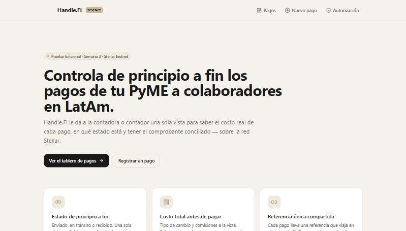
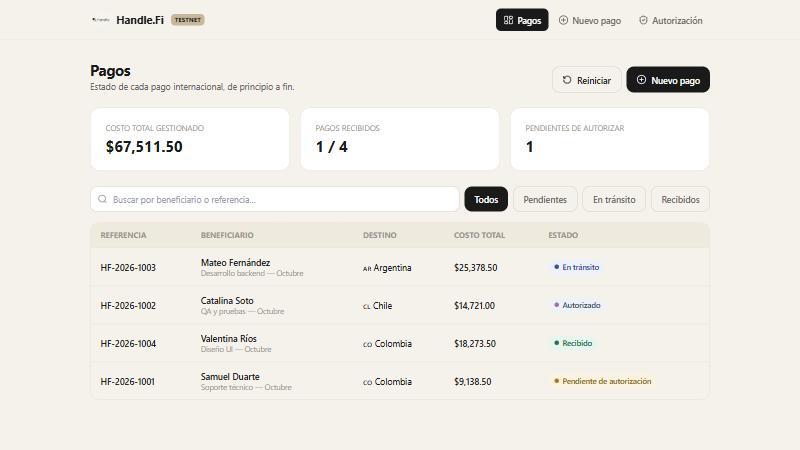
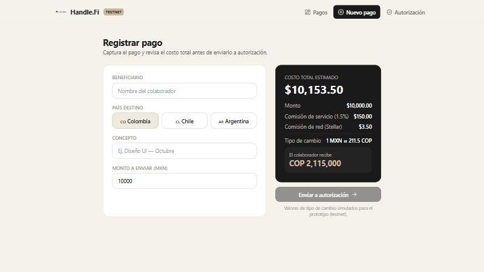
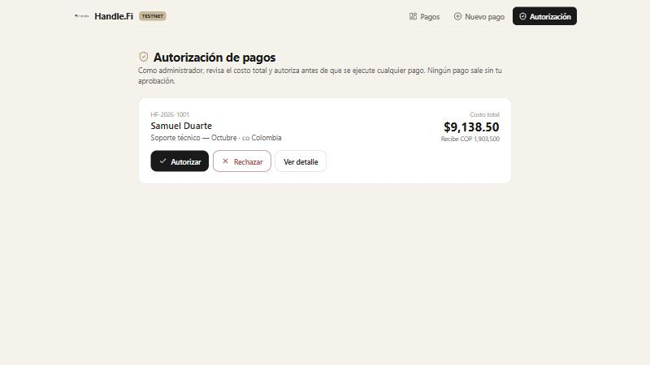
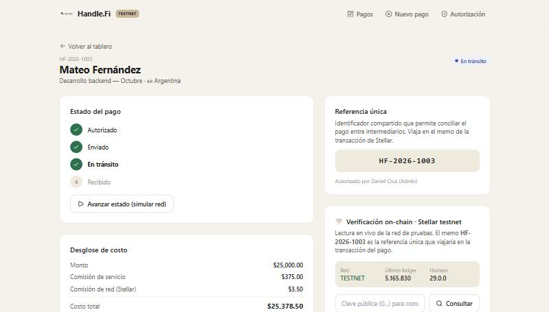
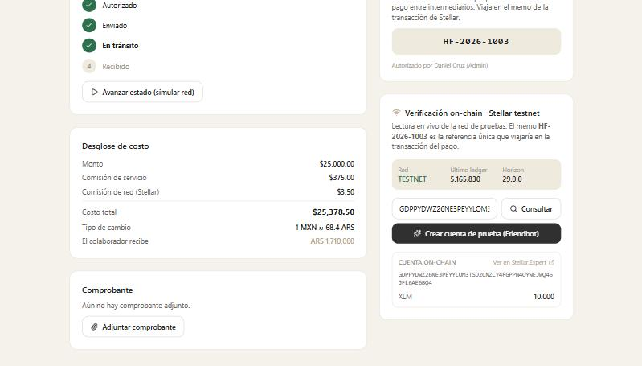

# Documentación — Semana 3 · Prueba Funcional (Functional Proof)

Proyecto: **Handle.Fi** — Control de pagos internacionales para PyMEs mexicanas.
Red utilizada: **Stellar testnet** (únicamente red de pruebas).

---

## 1. Front construido

Esta semana se construyó el **front del producto**, es decir, la parte visual por la
que el usuario recorre el flujo principal del MVP definido en el Product Blueprint
(Semana 2). El front vive en la carpeta `frontend/` del repositorio, está construido
con **Next.js 14 (App Router) + React + TypeScript + Tailwind CSS**, reutilizando el
sistema de diseño del proyecto original de Handle.Fi (paleta beige/tan, tipografía y
componentes) pero reorientado al flujo del MVP y a la red Stellar.

El front implementa el recorrido completo del flujo de usuario del Blueprint
(**registro → costo → autorización → ejecución en Stellar → estado → comprobante**),
a través de las siguientes vistas:

### Vistas implementadas y su relación con el MVP del Blueprint

| Vista | Ruta | Historia del MVP que cubre |
|-------|------|----------------------------|
| **Inicio / Landing** | `/` | Presenta la propuesta de valor y da entrada al flujo. |
| **Tablero de pagos (Dashboard)** | `/dashboard` | Historia 1 — *ver el estado de cada pago de principio a fin* (enviado / en tránsito / recibido), con buscador, filtros por estado e indicadores (KPIs). |
| **Registrar pago** | `/pagos/nuevo` | Historia 2 — *conocer el costo total real antes de ejecutar*: al capturar monto y país, se calcula en vivo el tipo de cambio, las comisiones, el costo total en pesos y el monto que recibe el colaborador en moneda local. |
| **Autorización** | `/autorizacion` | Historia 4 — *el dueño autoriza antes de ejecutar*: lista los pagos pendientes con su costo total y permite autorizar o rechazar. |
| **Detalle del pago** | `/pagos/detalle?id=…` | Historias 1, 3 y 6 — línea de tiempo del estado, desglose de costo, **referencia única** (que viajaría en el memo de Stellar), adjuntar/recuperar **comprobante** conciliado, y el panel de verificación on-chain. |

### Cómo se conectan las vistas con el flujo del Blueprint

El recorrido reproduce la secuencia numerada del Product Blueprint:

1. El contador **registra el pago** (`/pagos/nuevo`): beneficiario, país destino
   (Colombia, Chile o Argentina), concepto y monto en pesos.
2. El sistema **calcula el costo total** (tipo de cambio + comisión de servicio +
   comisión de red) y genera una **referencia única** (`HF-2026-XXXX`).
3. El dueño/admin **autoriza** el pago (`/autorizacion`). Ningún pago avanza sin este paso.
4. El pago se **ejecuta sobre Stellar** y su estado avanza
   (**autorizado → enviado → en tránsito → recibido**), visible en el detalle.
5. El contador **consulta el estado** y **adjunta/recupera el comprobante**,
   conciliado por la referencia única.

### Integración con Stellar testnet (lectura en vivo)

Además de las pantallas, el front incluye una **lectura real de la red Stellar testnet**
en el detalle del pago, mediante el SDK oficial `@stellar/stellar-sdk` contra
**Horizon testnet** (`https://horizon-testnet.stellar.org`). El panel de
*Verificación on-chain*:

- Muestra en vivo el **estado de la red** (red, último ledger, versión de Horizon),
  como prueba de conexión real a testnet.
- Permite **consultar cualquier cuenta** (clave pública `G...`) y ver su saldo on-chain.
- Permite **crear y financiar una cuenta de prueba** con **Friendbot**, y leer su saldo
  (10.000 XLM) directamente de la red, con enlace a Stellar.Expert para verificación externa.

Esto demuestra que el producto ya lee información real de testnet, aunque la ejecución
de pagos mediante contrato se implementa en la siguiente semana.

### Estado y persistencia

Al tratarse de una prueba funcional (front), los pagos se gestionan del lado del
cliente con un *store* en memoria respaldado por `localStorage`, precargado con datos de
ejemplo. Esto permite recorrer el flujo completo sin backend y desplegar el front como
sitio estático en Vercel. Los valores de tipo de cambio son **simulados** y están
claramente marcados como tales en la interfaz.

### Capturas de pantalla

**Inicio / propuesta de valor**

**Tablero de pagos — estado de principio a fin (Historia 1)**

**Registrar pago — costo total en vivo (Historia 2)**

**Autorización del dueño (Historia 4)**

**Detalle del pago — estado, costo y referencia única (Historias 1, 3, 6)**

**Verificación on-chain — lectura en vivo de Stellar testnet (cuenta creada con Friendbot)**

### Enlace al front hosteado

🔗 **Demo en Vercel:** `_[pegar aquí la URL de Vercel; también va en el campo Website de Apex]_`

---

## 2. Decisión técnica

**Opción elegida: A — Contrato propio (Soroban en Stellar testnet).**

El equipo decidió que creará su **propio contrato inteligente** sobre Stellar
(Soroban), en lugar de depender únicamente de una herramienta existente del
ecosistema. Esta semana solo se documenta la decisión; **no se escribe ni se
despliega código de contrato todavía** (eso corresponde a la Semana 4).

### Por qué un contrato propio

La decisión se apoya en el **uso de Stellar definido en el Product Blueprint**, donde
el valor diferenciador no es solo mover dinero, sino disponer de una **referencia
verificable y compartida** del estado y la autorización del pago entre participantes
independientes, ligada al control contable. Un contrato propio permite registrar
on-chain la lógica central del MVP:

- **Registro del pago y su referencia única** como entrada inmutable y auditable.
- **Autorización del dueño** como condición verificable antes de la liberación de fondos
  (la autorización deja de ser un dato en un sistema aislado y pasa a ser un hecho on-chain).
- **Estado del pago** (enviado → en tránsito → recibido) como fuente de verdad compartida,
  de modo que el contador no dependa de la confirmación manual de un portal bancario.

En otras palabras, el contrato propio materializa el punto de pertinencia del Problem
Brief: la trazabilidad de principio a fin se sostiene en una referencia compartida y
verificable, no en la mera confirmación de una transferencia.

### Qué se descartó

Se descartó la **Opción B (usar solo una solución existente del ecosistema)** como núcleo
de la lógica. Las piezas del ecosistema —Payments y memo de Stellar para transportar la
referencia, y anchors/Etherfuse para el on/off-ramp pesos↔moneda local— se **seguirán
aprovechando** para el movimiento de valor y la conversión de moneda, porque no tiene
sentido reimplementarlas. Pero esas herramientas, por sí solas, no modelan la lógica de
*autorización + estado + conciliación* que da valor a Handle.Fi; resuelven el transporte
del dinero, no el control del proceso. Por eso el equipo combina ambos mundos: **anchors
e infraestructura del ecosistema para mover el valor, y un contrato propio para la lógica
de control del pago**.

### Alcance para la próxima semana

- Definir el *data model* del contrato (pago, referencia, autorizador, estado).
- Implementar y desplegar el contrato Soroban en **testnet**.
- Conectar el front (ya construido) a las funciones del contrato para leer/escribir estado.

---

## 3. Participación del equipo

| Integrante | Usuario de GitHub | Aporte / responsabilidad |
|------------|-------------------|--------------------------|
| Daniel Adrián Elías Cruz Cervantes | [@DonCervantes](https://github.com/DonCervantes) | Construcción del front (Next.js + Tailwind), integración de lectura de Stellar testnet (Horizon + Friendbot), documentación de la semana 3 y decisión técnica, despliegue en Vercel. |

> Nota: Handle.Fi es un proyecto de un solo integrante. El commit individual de esta
> semana queda como evidencia de participación.

---

## 4. Bloqueos y siguiente paso

**Bloqueos / pendientes:**

- La ejecución real de pagos aún no está conectada a un contrato; el flujo de ejecución
  se muestra de forma simulada en el front (el estado avanza manualmente para demostrar
  el recorrido).
- Falta validar la cobertura real de anchors/off-ramp (Etherfuse y equivalentes) en los
  tres países destino, pendiente ya señalado desde el Problem Brief.
- Los tipos de cambio y comisiones son valores simulados; falta integrarlos con una fuente real.

**Siguiente paso hacia el MVP:**

1. Diseñar e implementar el **contrato Soroban** en testnet (registro de pago,
   autorización y estado), según la decisión técnica (Opción A).
2. Conectar el front a las funciones del contrato para que el estado del pago se lea
   y escriba on-chain.
3. Integrar el on/off-ramp (anchors/Etherfuse) para el movimiento real pesos↔moneda local
   en testnet.
